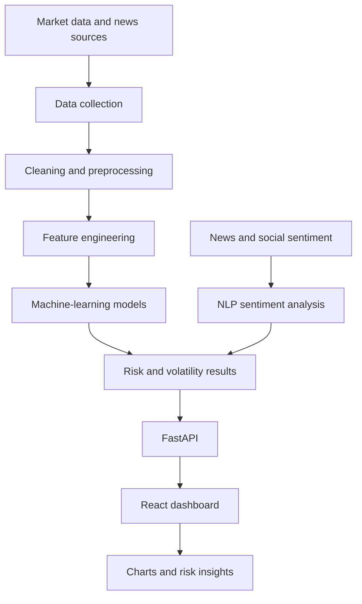

<div align="center">


<p><strong>Machine-learning-powered cryptocurrency risk assessment</strong></p>

<p>
  Turn market data, technical indicators, and news sentiment into a clearer view of crypto-market risk.
</p>

<p>
  
  
  
  
  
</p>

<p>
  <a href="#-features">Features</a> ·
  <a href="#-quick-start">Quick start</a> ·
  <a href="#-architecture">Architecture</a> ·
  <a href="#-api-reference">API reference</a> ·
  <a href="#-machine-learning">Machine learning</a>
</p>


</div>

## Overview

**Crypto Risk Lens** is a cryptocurrency analysis platform designed to estimate market risk using machine learning and market signals. It combines OHLCV data, technical indicators, volatility forecasting, market-regime detection, clustering, and sentiment analysis in one workflow.

> **Important:** Risk scores and forecasts are estimates, not financial advice or guarantees of future performance.

## ✨ Features

<table>
  <tr>
    <td width="50%" valign="top">

### Risk assessment
- Random Forest risk classification
- Low, medium, and high risk labels
- Class-probability and confidence outputs
- Market-regime-aware risk adjustment
- Uncertainty flagging

    </td>
    <td width="50%" valign="top">

### Technical analysis
- 30+ technical indicators
- RSI, MACD, Bollinger Bands, ATR, and more
- Seven-day volatility forecast
- Quantile-based prediction intervals
- Drawdown and risk metrics

    </td>
  </tr>
  <tr>
    <td width="50%" valign="top">

### Sentiment and market context
- News and social-feed collection
- CryptoBERT sentiment scoring
- Extractive NLP summarization
- Fear & Greed Index integration
- Market clustering and regime detection

    </td>
    <td width="50%" valign="top">

### Dashboard experience
- Interactive market visualizations
- Global market overview
- 3D globe visualization
- Responsive interface
- Motion-powered transitions

    </td>
  </tr>
</table>

## 🚀 Quick start

### Requirements

- Python 3.10 or newer
- Node.js 18 or newer
- npm
- Git

### 1. Clone the repository

```bash
git clone https://github.com/adityajkate/crypto-risk.git
cd crypto-risk
```

### 2. Set up the backend

```bash
pip install -r requirements.txt
cp .env.example .env
```

Add the required API keys and settings to `.env`. Then run the model-training pipeline for the first setup, if needed:

```bash
cd ml/scripts
python run_all.py
cd ../..
```

Start the API:

```bash
python run_api.py
```

- API: `http://localhost:8000`
- Interactive API documentation: `http://localhost:8000/docs`

### 3. Set up the frontend

Open a second terminal from the repository root:

```bash
cd frontend
npm install
npm run dev
```

Open the local URL printed by Vite. The project documentation currently lists `http://localhost:3000`; the actual port can vary if that port is already in use.

## 🧭 Architecture



### Processing stages

1. **Data collection:** Fetch cryptocurrency market data and collect supported news or social sources.
2. **Preprocessing:** Normalize market data into OHLCV format and prepare it for analysis.
3. **Feature engineering:** Calculate technical indicators and risk-related features.
4. **Model inference:** Estimate risk, volatility, market clusters, and market regime.
5. **API delivery:** Return analysis through FastAPI endpoints.
6. **Dashboard rendering:** Present results through interactive charts and visual components.

## 🗂️ Project structure

```text
crypto-risk/
├── backend/                  # FastAPI application
│   ├── api/                  # API endpoints and clients
│   ├── scrapers/             # News and social data collection
│   ├── services/             # NLP and application logic
│   └── workers/              # Background processing
├── ml/                       # Machine-learning pipeline
│   ├── scripts/              # Data preparation and training
│   └── data/                 # Training datasets
├── core/                     # Shared utilities
│   ├── feature_engine.py     # Technical indicators
│   ├── coingecko_client.py   # CoinGecko API client
│   └── models.py             # Shared data models
├── frontend/                 # React and TypeScript application
│   └── src/
│       ├── pages/            # Route-level components
│       ├── components/       # Reusable UI components
│       └── services/         # API integration
└── models/                   # Trained model artifacts
```

## 🔌 API reference

| Method | Endpoint | Purpose |
|---|---|---|
| `GET` | `/api/v1/coin/{id}/analysis` | Combined risk, volatility, cluster, and regime analysis |
| `GET` | `/api/v1/coin/{id}/risk` | Risk assessment |
| `GET` | `/api/v1/coin/{id}/price` | Price and market data |
| `GET` | `/api/v1/batch/analysis` | Batch analysis for up to 10 coins |
| `GET` | `/api/v1/sentiment/{currency}` | Sentiment analysis |
| `GET` | `/api/v1/trending` | Trending cryptocurrencies |
| `GET` | `/api/v1/global` | Global market metrics |
| `GET` | `/health` | API health check |

### Example analysis response

```json
{
  "risk_assessment": {
    "risk_label": "high",
    "probabilities": {
      "low": 0.04,
      "medium": 0.19,
      "high": 0.77
    },
    "confidence": 0.77,
    "is_uncertain": false,
    "regime_adjustment": "high_vol_crisis"
  },
  "volatility_forecast": {
    "predicted_volatility_7d": 0.028,
    "confidence_intervals": {
      "lower_10": 0.012,
      "median_50": 0.025,
      "upper_90": 0.051
    }
  },
  "market_cluster": {
    "cluster": 2
  },
  "market_regime": {
    "regime_name": "high_vol_crisis"
  }
}
```

*This is an illustrative response shape. Actual values depend on the data and model output.*

## 🧠 Machine learning

<p>
  
  
  
  
</p>

### Risk classifier
- **Algorithm:** Random Forest
- **Configuration documented by the project:** 500 trees, maximum depth 20
- **Output:** Low, medium, or high risk, with class probabilities
- **Inputs:** Technical indicators and market features

### Volatility forecaster
- **Algorithm:** Quantile Regression
- **Horizon:** Seven days
- **Output:** 10th, 50th, and 90th percentile estimates

### Market clustering
- **Algorithm:** K-Means
- **Output:** Groups with similar market behaviour
- **Inputs:** Seven selected market indicators

### Market-regime detection
- **Algorithm:** Gaussian Hidden Markov Model
- **Output:** Estimated market state, such as stable, transition, or crisis
- **Inputs:** Log returns and volatility

## 📈 Technical indicators

<details>
  <summary><strong>Show indicator categories</strong></summary>

  ### Trend
  - RSI — Relative Strength Index
  - MACD — Moving Average Convergence Divergence
  - ADX — Average Directional Index
  - CCI — Commodity Channel Index
  - Aroon Oscillator

  ### Volatility
  - Bollinger Bands
  - ATR — Average True Range
  - Standard deviation
  - Historical volatility

  ### Volume
  - OBV — On-Balance Volume
  - MFI — Money Flow Index
  - Volume ratio
  - VWAP — Volume Weighted Average Price

  ### Momentum
  - Stochastic RSI
  - Williams %R
  - ROC — Rate of Change
  - Momentum oscillator

  ### Risk metrics
  - Maximum drawdown
  - Recovery ratio
  - Drawdown duration
  - Sharpe ratio
</details>

## 🏋️ Training pipeline

Run the full pipeline from the repository root:

```bash
cd ml/scripts
python run_all.py
```

Or run individual stages:

```bash
python collect_training_data.py
python preprocess.py
python label_generator.py
python train_risk_classifier.py
python train_regression.py
python train_clustering.py
python train_regime_model.py
```

Run the stages in the intended order. Confirm that required data, environment variables, and dependencies are configured before training.

## ⚙️ Environment variables

Create a `.env` file in the repository root:

```dotenv
# CoinGecko
COINGECKO_API_KEY=your_coingecko_key

# Optional: Google Trends integration
# GOOGLE_API_KEY=your_google_key

# API server
API_HOST=0.0.0.0
API_PORT=8000
API_RELOAD=true

# Request pacing
RATE_LIMIT_DELAY=1.0
```

Do not commit `.env` files or API secrets to version control.

## 🧰 Technology stack

| Area | Tools |
|---|---|
| Backend | FastAPI, Uvicorn |
| Machine learning | scikit-learn, XGBoost, hmmlearn, statsmodels |
| Technical analysis | TA-Lib |
| NLP | Transformers, PyTorch, Sentence-Transformers |
| Data processing | pandas, NumPy, httpx, aiohttp |
| Frontend | React, TypeScript, Vite |
| 3D visualization | Three.js, React Three Fiber |
| Charts | Recharts, D3.js |
| Animation | Motion (Framer Motion) |
| UI utilities | Lucide Icons, Rough Notation |
| Market data | CoinGecko API |
| Sentiment sources | RSS, Reddit API, Google News |
| Trends and sentiment metrics | Google Trends, Fear & Greed Index |

## 👥 Contributors

<table>
  <tr>
    <td align="center">
      <a href="https://github.com/adityajkate">
        <strong>Aditya Kate</strong>
      </a>
      <br />
      <sub>Developer</sub>
    </td>
    <td align="center">
      <strong>Tanmay Harmalkar</strong>
      <br />
      <sub>Developer</sub>
    </td>
    <td align="center">
      <strong>Suman Manik</strong>
      <br />
      <sub>Developer</sub>
    </td>
    <td align="center">
      <strong>Abdullah Khan</strong>
      <br />
      <sub>Developer</sub>
    </td>
  </tr>
</table>

## 📄 License

This project is licensed under the **MIT License**.

---

<div align="center">

<a href="https://github.com/adityajkate/crypto-risk">
  
</a>
<a href="https://github.com/adityajkate/crypto-risk/issues">
  
</a>
<a href="https://github.com/adityajkate/crypto-risk/network/members">
  
</a>

<br /><br />


<sub>Built for clearer cryptocurrency market analysis.</sub>

</div>
